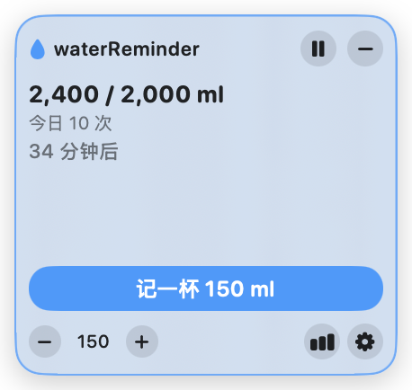
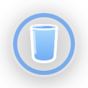
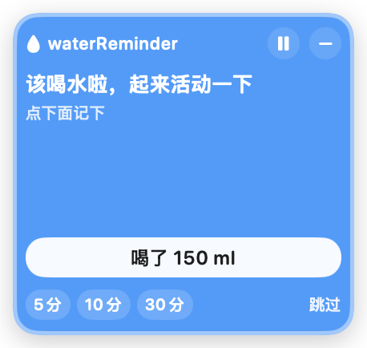
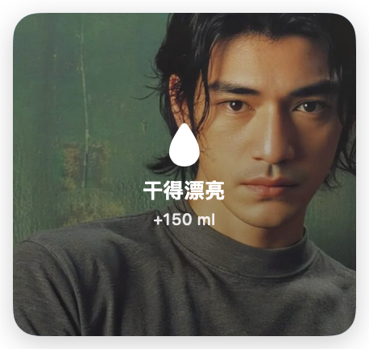
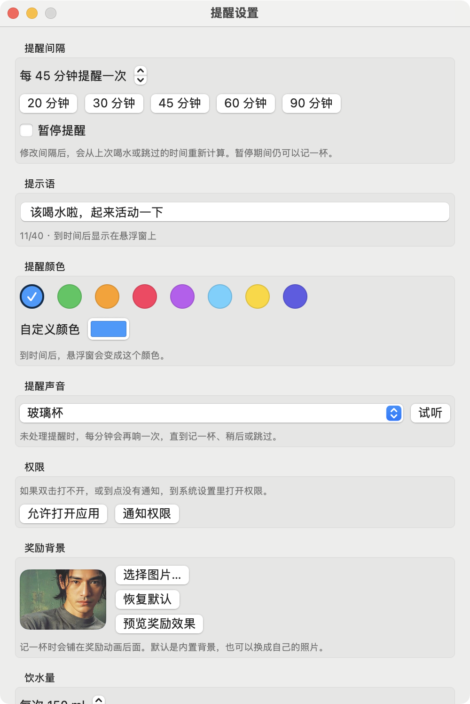
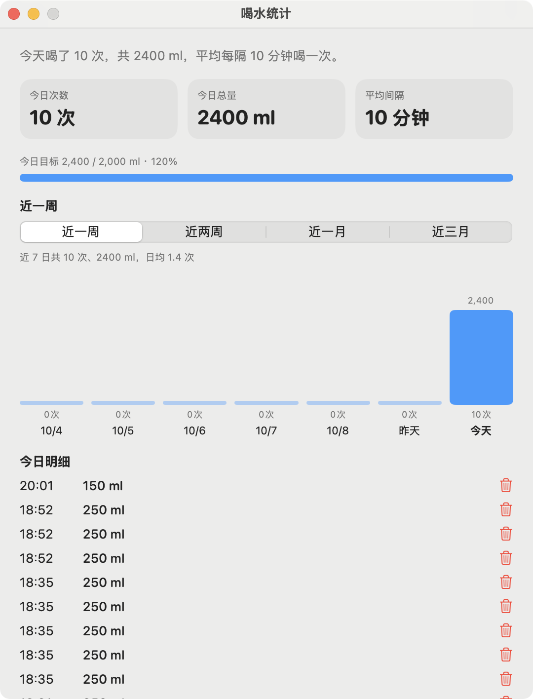

# waterReminder

Mac 桌面悬浮喝水提醒。窗口始终浮在桌面上，到点变色、出提示语、播放声音，并统计喝水次数和总量。

## 安装

### 用 DMG 安装（推荐）

1. 下载仓库里的 [release/waterReminder-1.0.dmg](https://github.com/Sherry741/waterReminder/raw/main/release/waterReminder-1.0.dmg)
2. 双击打开 DMG
3. 双击 **安装并打开**（不要直接双击 `.app`）
4. <span style="color:#d1242f"><strong>应用打开后，按引导去系统设置允许打开，并打开通知权限</strong></span>

> [!CAUTION]
> <span style="color:#d1242f">当前是本机临时签名，没有苹果开发者证书。从浏览器下载后，系统会先拦截未公证的应用。用「安装并打开」会去掉隔离标记；如果仍然被拦，到「系统设置 → 隐私与安全性」拉到下面点「仍要打开」。</span>

最低系统：macOS 14。当前安装包为 Apple Silicon（arm64）。

### 从源码运行

```bash
./build.sh
open dist/WaterReminder.app
```

打可安装的 DMG：

```bash
./package-dmg.sh
```

完成后得到 `dist/waterReminder-1.0.dmg`。需要放到仓库里时，把文件复制到 `release/` 再提交。

## 使用方法

<p>
  
  &nbsp;&nbsp;
  
</p>

### 悬浮窗

- 拖动标题栏可移动，位置会记住
- 点 **记一杯** 按当前毫升数记账，并重新开始倒计时
- **− / +** 每次调整 50 ml
- 右上角 **−** 收成水杯小图标；点水杯重新展开
- 展开后，鼠标移到窗口边缘会出现缩放光标，拖边可改大小

### 提醒



到点后窗口变成你设的颜色，显示提示语并播放声音。可以：

- **喝了**：记下这一杯，开始下一轮
- **5 / 10 / 30 分**：稍后提醒
- **跳过**：不记账，直接开始下一轮

菜单栏水滴图标也可以记一杯、暂停/继续、打开统计和设置。

### 奖励



每次点「记一杯」，或提醒里点「喝了」，悬浮窗会播放奖励动画。默认背景是内置的金城武照片。

换背景图：打开设置，在 **奖励背景** 里点 **选择图片…**，选一张本地照片即可。之后每次记一杯都会铺在动画后面。

- **预览奖励效果**：不用真记一杯也能看动画
- **恢复默认**：换回内置的金城武照片

### 设置



点齿轮，或菜单栏里的「设置…」：

- 提醒间隔（默认 45 分钟）
- 提示语
- 提醒颜色
- 提醒声音（可试听，也可设为无）
- 奖励背景（默认金城武，可换成自己的照片）
- 每次饮水量、每日目标
- **预览提醒效果**
- **暂停提醒**：不再响，但仍可记账

### 统计



点柱状图，或菜单栏里的「统计…」：

- 今日次数、总量、平均间隔
- 可切换近一周、近两周、近一月、近三月；三月按周汇总
- 删除某条记录，或补记一杯（补记只进统计，不推迟下次提醒）

数据保存在本机：

`~/Library/Application Support/WaterReminder/data.json`
